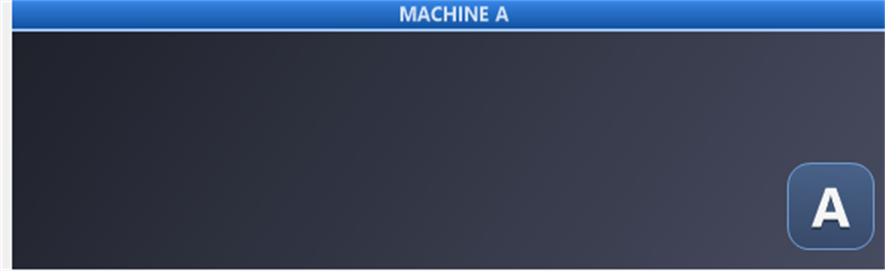
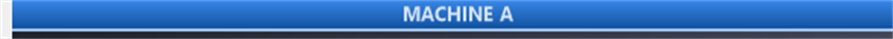
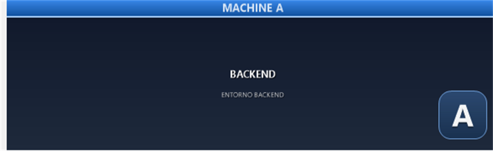
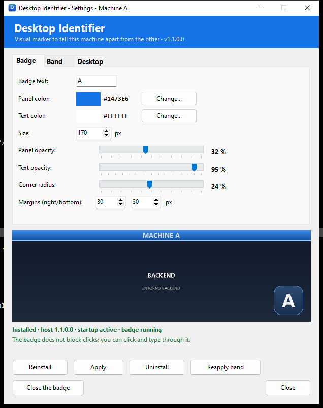
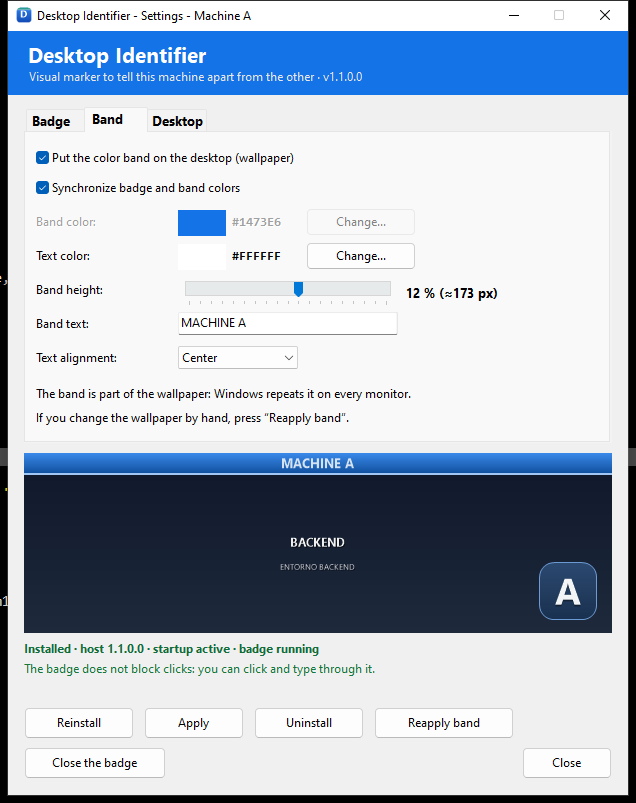
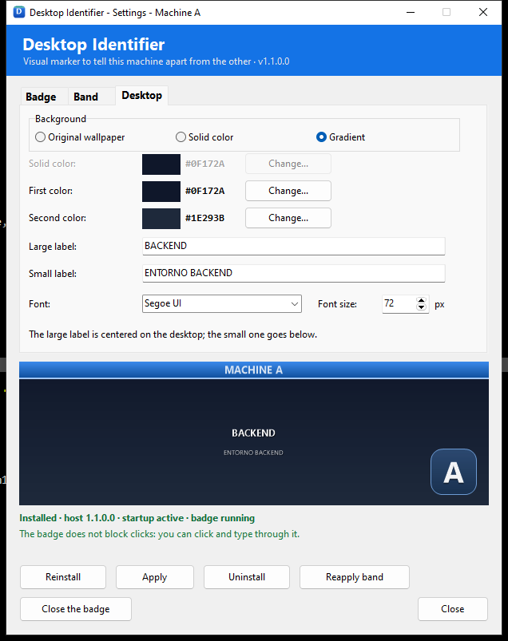

# Desktop Identifier

**Know at a glance which virtual machine you are working on.**

Two cloned VMs usually share the same wallpaper, icons and window layout. It is
easy to run a command, delete a file or open a browser in the wrong one.
Desktop Identifier marks the desktop with a permanent color band, a floating
badge and optional large/small desktop labels, so the answer is visible without
thinking.

**[Download the installer](dist/DesktopIdentifier-Setup.exe)** · Windows 10/11 ·
per-user, no administrator rights.



*Preview: a blue **MACHINE A** band at the top and the floating **A** badge at
the bottom right. The band is part of the wallpaper; the badge floats above the
desktop.*

---

## Why it helps

- **Instant identification:** the band and the badge are visible even when the
  desktop is full of windows.
- **No extra window in the way:** the badge is click-through, so you can keep
  working underneath it.
- **Three independent marks:** use the top band, the floating badge, the large
  and small desktop labels, or any combination. A blue `A` for one VM and an
  orange `B` for the other is a good start.
- **Every session:** the badge starts with Windows and the band is part of the
  wallpaper, so the mark is there before you open anything.
- **Useful for QA, support, training, demos and remote sessions**, where two
  machines look the same on screen.

It is a visual aid, not a security boundary: someone can still change the
configuration if they have access to the session.

## What it looks like

### The band



The band is baked into the wallpaper at the top of the screen. Choose its color,
height, text, text color and alignment (left, center or right). Windows repeats
the wallpaper on every monitor, so the band appears on all of them.

### The floating badge


The badge is a small always-on-top window at the bottom right. You can change
its text, panel color, text color, size, panel/text opacity, corner radius and
margins. It is semi-transparent and **does not capture the mouse**: clicks and
typing go to the window below it.

The badge text has **no length limit**. The box widens horizontally to fit the
text; a single character keeps the classic square shape. For example, `A` stays
square and `DESKTOP-A` becomes a wide pill that shows the whole word.

### One color or two

By default the **band color follows the badge color**. The Band tab has a
*Synchronize badge and band colors* checkbox; while it is checked, the band
color controls are disabled and the band always matches the badge. Uncheck it
to choose a different color for the band.

### The desktop background and label

The **Desktop** tab changes what is behind the band and the badge:

- **Original wallpaper:** keeps the user's current wallpaper and saves a copy
  of it for uninstall.
- **Solid color:** fills the desktop with the selected color.
- **Gradient:** blends two selected colors from top to bottom.

Any of the three can show two labels: a large one centered on the desktop and a
smaller one below it. Choose the font family and the base font size; the small
label is derived from it (42 % of the large size) so both look proportional.
Both labels are white with a soft shadow and are optional: leave a field empty
to omit that line. The band, if enabled, is drawn on top of the labels.

The original wallpaper is copied before the first custom desktop is applied and
is restored when the application is uninstalled. This is true for all three
background types, not only for *Original wallpaper*. The result is one composed
wallpaper, so Windows repeats it on every monitor, like the band.



## Features

- **Band** at the top of the desktop: color, height, text, text color and
  alignment; part of the wallpaper and repeated on every monitor.
- **Floating badge**: any text, automatic width, panel and text colors, size,
  opacities, corners and margins; click-through and always on top.
- **Desktop tab**: original wallpaper, solid color or gradient, plus a large
  centered label and a smaller label below, with selectable font and size.
- **Color synchronization** between badge and band, on by default.
- **Faithful preview** on three tabs (Badge, Band and Desktop), using the same
  GDI+ renderers as the host and the wallpaper generator.
- **Five UI languages**: Spanish, English, French, Italian and German, chosen at
  startup from the Windows locale.
- **Automatic startup** with the Windows session.
- **Guided update and repair**: the configurator detects a newer host or an
  incomplete installation.
- **Normal Windows installation**: Start menu shortcut and an entry in
  *Installed apps*; no administrator rights.
- **Clean uninstall**: removes the host, the startup entry, the applied
  wallpaper and the application data, and restores the original wallpaper.

## Install

1. Download **[DesktopIdentifier-Setup.exe](dist/DesktopIdentifier-Setup.exe)**.
2. Run the installer. It installs for the current user in
   `%LOCALAPPDATA%\Programs\Desktop Identifier` and does not need administrator
   rights.
3. Open **Desktop Identifier** from the Start menu.

The visible product name is **Desktop Identifier**. Executable filenames, the
data folder and the internal names keep the historical `DesktopIdentifier`
spelling; only user-facing text uses the spaced name.

The setup registers the application in Windows *Installed apps* and creates a
Start menu shortcut. **Only the configurator appears in those places.** The
startup program (`DesktopIdentifierHost.exe`) is intentionally hidden from the
Start menu and from *Installed apps*, but the uninstaller removes it together
with the startup entry and the data.

To uninstall, use *Settings → Apps → Desktop Identifier → Uninstall* (or the
uninstaller in the installation folder). The uninstaller closes the badge,
removes the host, restores the original wallpaper and deletes the application
data.

## Quick start

1. Open **Desktop Identifier**.
2. In the **Badge** tab, type the text you want (`A`, `B`, `VM-1`, a machine
   name, anything). The preview updates as you type.
3. Pick a panel color. If **Synchronize badge and band colors** is checked (the
   default), the band uses the same color.
4. In the **Band** tab, enable the band, enter the label you want (for example
   `MACHINE A`), and choose its height and alignment.
5. In the **Desktop** tab, choose the original wallpaper, a solid color or a
   gradient, and optionally enter the large and small labels.
6. Press **Apply**. The band, background and labels are written to the wallpaper
   and the badge is reloaded.
7. Close the configurator. The badge stays on screen and starts automatically
   with Windows.

The status line at the bottom of the window shows whether the host is installed,
whether startup is active and whether the badge is running.

## Settings

The three tabs use a bold, slightly larger caption so they are easy to find,
while the controls keep the normal application font.

| Badge tab | Band tab |
|---|---|
|  |  |

**Badge:** text (no length limit), panel color, text color, size, panel opacity,
text opacity, corner radius, right/bottom margins and monitor.

**Band:** enable/disable, color (or synchronized with the badge), height, text
(no length limit; the font is reduced if the band is too narrow), text color and
alignment.

**Desktop:**



Choose **original wallpaper**, **solid color** or **gradient**. For a solid color
there is one color; for a gradient there are two, blended from top to bottom.
Both labels are optional: the large one is centered on the desktop and the small
one is placed below it. The font family and base size apply to both; the small
label is scaled down proportionally. The large label is scaled to the screen
resolution. The labels are white with a shadow, and the band is drawn on top of
them.

## Configuration file

The configurator saves changes to
`%LOCALAPPDATA%\DesktopIdentifier\desktopidentifier.ini` with atomic writes. The
host re-reads it when it receives the `DesktopIdentifier_RELOAD` message, so
**Apply** does not restart the host. The Desktop tab uses this section:

```ini
[desktop]
fondo=original
color=#1473E6
color2=#2A9D8F
texto_grande=
texto_pequeno=
fuente=Segoe UI
tamano=72
```

| Key | Values | Meaning |
|---|---|---|
| `fondo` | `original`, `solido`, `degradado` | Background type |
| `color` | `#RRGGBB` | Solid color, or first gradient color |
| `color2` | `#RRGGBB` | Second gradient color |
| `texto_grande` | any text | Large label; empty means no line |
| `texto_pequeno` | any text | Small label; empty means no line |
| `fuente` | font family | Default `Segoe UI` |
| `tamano` | 24–200 | Large label size at 1080p; scaled to the screen |

The small label uses 42 % of `tamano`. The values are validated while loading;
an empty font falls back to `Segoe UI` and the size is clamped to the range.

## Languages

The UI follows the Windows locale:

| Locale | Language |
|---|---|
| `es-*` | Spanish |
| `fr-*` | French |
| `it-*` | Italian |
| `de-*` | German |
| anything else | English |

There is no manual selector and no environment variable: the language is chosen
at startup. The host title and its startup error message use the same language.
The strings live in `src/common/Languages.pas`; adding a language means adding a
column to the table and a case in the detector.

## Startup, update and repair

- **Startup:** installing writes one per-user entry under
  `HKCU\Software\Microsoft\Windows\CurrentVersion\Run`. The host starts with the
  session and paints the badge.
- **Update:** if the host that comes with the configurator is newer than the
  installed one, the main button changes to **Update** and asks for confirmation.
  The settings and the startup entry are preserved.
- **Repair:** if the startup entry, the INI or the host is missing, or the
  startup entry points to the wrong place, the window shows the specific problem
  and offers **Repair**.
- **Reinstall:** copies the host again and reapplies the current settings.

## How it works

There are two programs:

| Program | Executable | Role |
|---|---|---|
| Configurator | `DesktopIdentifier.exe` | Settings window, desktop composition, band generation, installation and uninstallation |
| Startup program | `DesktopIdentifierHost.exe` | Only the floating badge; Win32 without VCL |

**The desktop** is composed by the configurator at the real screen resolution.
It uses the saved original wallpaper, a solid color or a two-color gradient,
then draws the two labels (large centered, small below) and the band before
applying the image with `SystemParametersInfo(SPI_SETDESKWALLPAPER)`. The
original wallpaper is saved in `fondo-original.dat` / `fondo-original.ini` and
restored on uninstall.

**The badge** is a layered Win32 window
(`WS_EX_LAYERED | WS_EX_TRANSPARENT | WS_EX_TOOLWINDOW | WS_EX_NOACTIVATE`,
`HWND_TOPMOST`). It draws with GDI+ into a 32-bpp premultiplied DIB and updates it
with `UpdateLayeredWindow`. A timer reasserts the topmost order and repositions
the badge if the monitor, the work area or the DPI changes.

The host does not use VCL. It reads the INI with the Win32 API and keeps the
settings in its own record; linking `System.Classes` would make the executable
grow above 1 MB. The result is a small background process that spends most of
its time doing nothing.

The configurator and the host communicate with the registered messages
`DesktopIdentifier_RELOAD` and `DesktopIdentifier_QUIT`; a mutex
(`Local\DesktopIdentifier_Host`) keeps a single host instance.

## Files and data

The application data lives in `%LOCALAPPDATA%\DesktopIdentifier`:

```
desktopidentifier.ini     settings
DesktopIdentifierHost.exe installed startup program
fondo-distintivo.png      wallpaper with the band and desktop labels
fondo-original.dat/.ini   copy and data of the original wallpaper
```

The installed application lives in
`%LOCALAPPDATA%\Programs\Desktop Identifier` and includes the configurator, the
host source used by repair/update, and the uninstaller.

## Build from source

Requirements: **RAD Studio / Delphi 12 (23.0), Win32**. No third-party Delphi
packages.

```bat
Compilar.cmd --no-pause
```

This builds:

```
bin\DesktopIdentifierHost.exe   ~480 KB   (without VCL)
bin\DesktopIdentifier.exe       ~3.0 MB   (VCL, configurator + icon)
```

To build the Windows installer:

```bat
CrearInstalador.cmd
```

`CrearInstalador.cmd` compiles both executables and then runs Inno Setup 6 to
produce `dist\DesktopIdentifier-Setup.exe`. The installer script is
`installer\DesktopIdentifier.iss`.

The project is organized as:

```
src\common\   shared units (paths, settings, badge rendering, languages)
src\config\   configurator (VCL), band renderer, wallpaper, install, version
src\host\     startup program and layered window (no VCL)
installer\    Inno Setup script
docs\         plan, phase notes and screenshots
```

## Limitations

- The band is part of the wallpaper, so it is the same on every monitor. If you
  change the wallpaper by hand, the band disappears; press **Reapply band**,
  which rebuilds it from the saved original wallpaper. The same happens to the
  **Desktop** background and labels when the selected background is the original
  wallpaper.
- The **Desktop** background and labels are also part of the wallpaper. The
  labels are white with a shadow; they are designed to read on the colors and
  wallpapers shown in the preview.
- In exclusive full-screen applications the badge may be hidden.
- The host has no tray icon or window of its own; it is managed from the
  configurator.
- The host has no custom icon and the executables are not digitally signed.
- This is a visual aid, not a security mechanism.

## License

The source code is released under the **MIT License**. See [LICENSE](LICENSE).
Copyright © 2026 Juan C. Cilleruelo.

## Documentation

- [Plan for splitting the application into two programs](docs/PLAN-DOS-PROGRAMAS.md)
- [Phase 1: separation of configurator and host](docs/FASE-1.md)
- [Phase 2: badge and band options](docs/FASE-2.md)
- [Phase 3: version, update and repair](docs/FASE-3.md)
- [Original context handover](docs/TRASPASO.md)

Current version: **1.1.0.0**.
